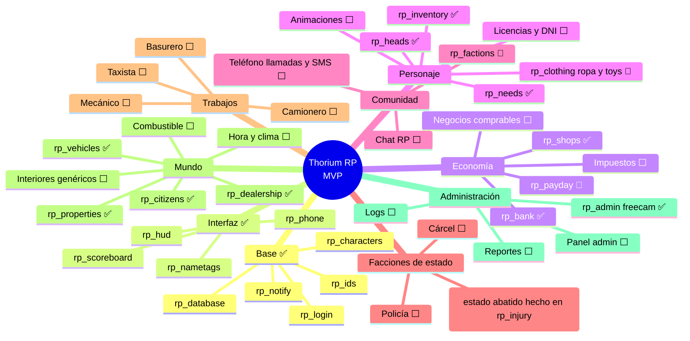

# Plan del MVP de roleplay

Este documento es el mapa de lo que ya tiene Thorium y de lo que falta para tener un **MVP de roleplay**: un servidor donde un jugador nuevo pueda entrar, crear su personaje, conseguir un trabajo o entrar a una facción, ganar dinero, gastarlo y rolear con otros con reglas claras y herramientas de administración.

Estados: ✅ hecho · 🚧 en curso (rama abierta) · ⬜ pendiente

## Mapa mental

## Lo que ya está

| Área | Recursos |
|---|---|
| Base | `rp_database`, `rp_login`, `rp_characters`, `rp_ids`, `rp_notify` |
| Personaje | `rp_heads`, `bone_attach`, `rp_needs`, `rp_inventory` |
| Economía | `rp_bank`, `rp_shops`, `rp_dealership` |
| Mundo | `rp_properties`, `rp_vehicles`, `rp_citizens` |
| Interfaz | `rp_hud`, `rp_scoreboard`, `rp_nametags`, `rp_phone` |
| Admin | `rp_admin` (solo `/freecam`) |

## En curso

| Recurso | Qué hace |
|---|---|
| `rp_factions` | Facciones con panel en **F3**. El líder crea roles, define sus permisos y su sueldo. Cada miembro solo ve y usa lo que su rol permite. Fondos de facción, registro de actividad, invitaciones y chat `/f`. |
| `rp_payday` | Cada **60 minutos de juego** (acumulados por personaje, sin contar AFK) se paga el sueldo del rol en la facción. Sin facción, el Estado paga un sueldo base. El dinero va al banco con su movimiento en el historial. |
| `rp_clothing` | Tiendas de ropa con interior propio (Binco, SubUrban, ProLaps, ZIP, Victim, Didier Sachs). Probador en vivo y compra de ropa (o skin). Toys: accesorios pegados a un hueso con `bone_attach`, con editor de posición, rotación y tamaño guardado por personaje. |

## Lo que falta para el MVP

Ordenado por prioridad. La **fase 1** es lo mínimo para abrir el servidor a jugadores.

### Fase 1: MVP jugable

| # | Recurso | Qué debe hacer | Depende de |
|---|---|---|---|
| 1 | `rp_chat` | Chat por proximidad. `/me`, `/do`, `/b` (OOC local), `/s` (gritar), `/w` (susurrar), `/o` (OOC global, admin lo puede apagar). Colores por distancia. | `rp_characters` |
| 2 | `rp_police` | Facción de estado sobre `rp_factions`: esposar, cachear, arrestar, multas, cárcel con tiempo, sirena y `/buscados`. Permisos del rol controlan qué puede hacer cada agente. | `rp_factions`, `rp_inventory` |
| 3 | `rp_medic` | 🚧 La parte de **herido** ya está en `rp_injury`: abatido 2 minutos (se reanuda al reconectar), hospital y factura. Falta la facción de médicos que reanime usando el export `revivePlayer`. | `rp_factions`, `rp_bank`, `rp_injury` |
| 4 | `rp_licenses` | DNI del personaje, licencia de conducir con examen en autoescuela y licencia de armas. Se muestran con `/mostrar`. Ítems en el inventario. | `rp_inventory` |
| 5 | `rp_jobs` | Dos o tres trabajos civiles con rutas (camionero, basurero, taxista). Pago por tarea. Es la vía de ingreso de quien no tiene facción. | `rp_vehicles`, `rp_bank` |
| 6 | `rp_fuel` | Combustible por vehículo, gasolineras con pago. Sin gasolina el motor se apaga. | `rp_vehicles` |
| 7 | `rp_reports` + panel admin | `/reporte` de jugadores, cola para admins, `/ir`, `/traer`, `/spec`, `/kick`, `/ban` (temporal y permanente en SQL), `/jail` OOC. Niveles de admin según `accounts.admin_level`. | `rp_login`, `rp_ids` |
| 8 | `rp_logs` | Registro en SQL de dinero, compras, transferencias, acciones de admin y facciones, para investigar abusos. | `rp_database` |

### Fase 2: profundidad

| # | Recurso | Qué debe hacer |
|---|---|---|
| 9 | `rp_interiors` | Entradas y salidas genéricas creadas por admin (negocios, edificios públicos), sin depender de cada recurso. |
| 10 | `rp_business` | Negocios comprables que generan ingresos y se reabastecen. |
| 11 | `rp_weapons` | Armas como ítems del inventario, munición, armería con licencia, guardado al desconectar. |
| 12 | `rp_mechanic` | Reparar, tunear y remolcar vehículos (trabajo o facción). |
| 13 | `rp_phone` (ampliar) | Llamadas y SMS entre números, app de facción y de trabajos. |
| 14 | `rp_anims` | `/anim` con lista de animaciones, caminar y estilos. |
| 15 | `rp_world` | Hora y clima sincronizados para todos. |
| 16 | Impuestos | Impuesto sobre el payday y sobre propiedades, que financia a las facciones de estado. |

### Fase 3: pulido

- Tutorial para jugadores nuevos.
- Tono de piel de brazos según raza (pendiente de `rp_heads`).
- Verificar en juego las coordenadas de casas, concesionario y tiendas de ropa.
- Discord: logs y verificación de cuentas (opcional).

## Orden sugerido

1. Cerrar lo que está en curso: `rp_factions`, `rp_payday`, `rp_clothing`.
2. `rp_chat`, `rp_reports` y `rp_logs`: sin esto no se puede moderar un servidor abierto.
3. `rp_police` y `rp_medic`: son las primeras facciones de estado y usan los permisos de `rp_factions`.
4. `rp_licenses`, `rp_jobs` y `rp_fuel`: completan la economía básica.
5. Fase 2 según lo que pidan los jugadores.

## Convenciones para recursos nuevos

- Un recurso `rp_*` por sistema, en `resources/[roleplay]/`, registrado en `mtaserver.conf` después de sus dependencias.
- Tablas nuevas al final de `rp_database/schema.lua` con `CREATE TABLE IF NOT EXISTS` o `ALTER ... IF NOT EXISTS`.
- Toda validación en el servidor; consultas parametrizadas; cobros atómicos (`UPDATE ... WHERE saldo >= ?`).
- Interfaces CEF con la misma paleta que `rp_shops` y `rp_inventory`.
- Notificaciones con `exports.rp_notify:notify(player, texto, tipo)`.
